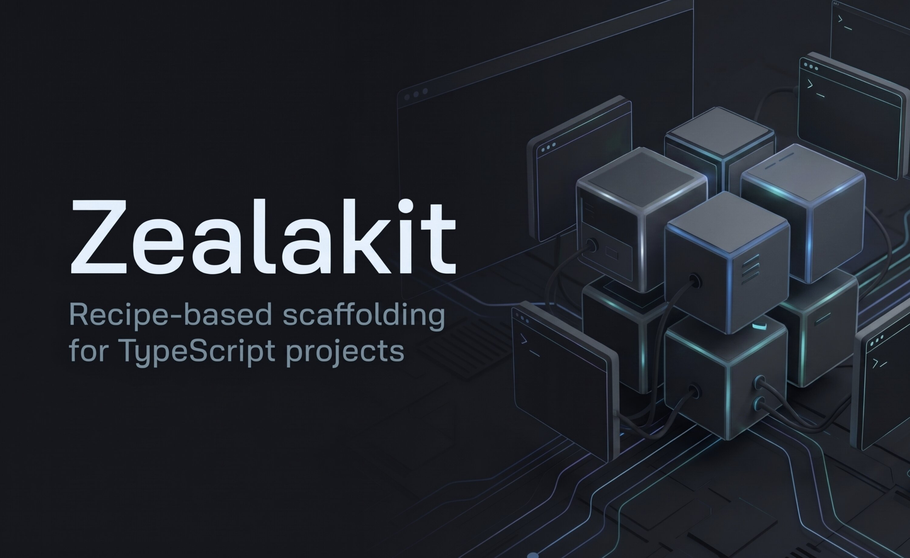

# Zealakit

<p align="center">
  
</p>

**Recipe-based scaffolding for TypeScript projects.**

Pick a template, add only the recipes you need, and get a ready-to-install project — dependencies, scripts, and AI-agent docs included. No global install required.

[English](https://github.com/zealakit/zealakit/blob/main/README.md) · [Tiếng Việt](https://github.com/zealakit/zealakit/blob/main/README_VI.md) · [中文](https://github.com/zealakit/zealakit/blob/main/README_CN.md)

```bash
npx zealakit@latest my-app
```

---

## Why Zealakit?

Most starters are either empty or overloaded. Zealakit lets you compose:

1. **Template** — Vite + React, Vite + Vue, Next.js, NestJS, or Hono
2. **Recipes** — optional layers (Biome, Zustand, shadcn/ui, Drizzle, Storybook, …)

Each recipe brings files, packages, scripts, and agent guidance when relevant. The result is a normal standalone project — use `npm`, `pnpm`, `yarn`, or `bun`.

---

## Requirements

- **Node.js 18+**

---

## Quick start

```bash
npx zealakit@latest my-app
```

Answer the prompts (template → recipes → confirm), then:

```bash
cd my-app
npm install
npm run dev
```

### Non-interactive

```bash
npx zealakit@latest my-app -t next -w biome,shadcn-ui,storybook -y
npx zealakit@latest api -t nest -w biome,drizzle-orm -y
```

- Without `-w`, the CLI is interactive.
- `-y` needs a project name and skips confirmation prompts.

---

## CLI

```text
npx zealakit@latest [project-name] [options]
```

| Option                 | Description                                       |
| ---------------------- | ------------------------------------------------- |
| `-t, --template <id>`  | Base template (default: `vite-react`)             |
| `-w, --with <recipes>` | Comma-separated recipe IDs (e.g. `biome,zustand`) |
| `-y, --yes`            | Non-interactive mode (requires a project name)    |
| `-h, --help`           | Show help                                         |
| `-V, --version`        | Show version                                      |

**Rules**

- Project names follow npm naming (lowercase, no spaces).
- Existing non-empty folders ask before overwrite; with `-y` they are rejected.
- Invalid or conflicting recipes are rejected **before** any files are written.

---

## Templates

| ID           | Kind       | Stack                           | Dev command         |
| ------------ | ---------- | ------------------------------- | ------------------- |
| `vite-react` | Client     | Vite + React + TypeScript       | `npm run dev`       |
| `vite-vue`   | Client     | Vite + Vue + TypeScript         | `npm run dev`       |
| `next`       | Full-stack | Next.js App Router + TypeScript | `npm run dev`       |
| `nuxt`       | Full-stack | Nuxt + TypeScript               | `npm run dev`       |
| `nest`       | Server     | NestJS + TypeScript             | `npm run start:dev` |
| `hono`       | Server     | Hono + TypeScript               | `npm run dev`       |

Every project includes TypeScript, path aliases, and agent docs (`.agents/`, `AGENTS.md`).

---

## Recipes

Choose **at most one** recipe per exclusive category (linter, state, UI kit, HTTP client, ORM, …).

Exceptions:

- **`storybook`** — can be combined with a UI kit
- **`client-shared-pieces`** — added automatically on Vite, Next, and Nuxt

| Recipe             | Category       | Templates             | Adds                          |
| ------------------ | -------------- | --------------------- | ----------------------------- |
| `biome`            | Linter         | All                   | Lint + format scripts         |
| `eslint`           | Linter         | All                   | ESLint flat config            |
| `zustand`          | State          | Vite React, Next      | Zustand store example         |
| `pinia`            | State          | Vite Vue, Nuxt        | Pinia store example           |
| `nanostores`       | State          | Vite, Next, Nuxt      | Nanostores example            |
| `hookform-zod`     | Forms          | Vite React, Next      | React Hook Form + Zod         |
| `vee-validate-zod` | Forms          | Vite Vue, Nuxt        | VeeValidate + Zod             |
| `kyjs`             | HTTP           | Vite, Next, Nuxt      | Ky client                     |
| `axios`            | HTTP           | Vite, Next, Nuxt      | Axios client                  |
| `antd`             | UI             | Vite React, Next      | Ant Design setup              |
| `mui`              | UI             | Vite React, Next      | MUI setup                     |
| `shadcn-ui`        | UI             | Vite React, Next      | Tailwind + shadcn/ui          |
| `shadcn-vue`       | UI             | Vite Vue, Nuxt        | Tailwind + shadcn-vue         |
| `nuxt-ui`          | UI             | Vite Vue, Nuxt        | Tailwind + Nuxt UI            |
| `storybook`        | Docs / testing | Vite, Next, Nuxt      | Storybook config + scripts    |
| `type-orm`         | ORM            | Nest, Hono       | TypeORM wiring + agent skill  |
| `mikro-orm`        | ORM            | Nest, Hono       | MikroORM wiring + agent skill |
| `drizzle-orm`      | ORM            | Nest, Hono       | Drizzle + drizzle-kit scripts |

ORM recipes are driver-agnostic. After scaffolding, install your DB driver (`pg`, `mysql2`, …) and follow the skill under `.agents/skills/<orm>/`.

### Examples

```bash
# SPA: Biome, Zustand, forms, Ky
npx zealakit@latest web -t vite-react -w biome,zustand,hookform-zod,kyjs -y

# Vue SPA: Biome, Pinia, VeeValidate, Ky, shadcn-vue
npx zealakit@latest web-vue -t vite-vue -w biome,pinia,vee-validate-zod,kyjs,shadcn-vue -y

# Nuxt: Biome, Pinia, VeeValidate, Ky, Nuxt UI
npx zealakit@latest web-nuxt -t nuxt -w biome,pinia,vee-validate-zod,kyjs,nuxt-ui -y

# Next.js: shadcn/ui + Storybook
npx zealakit@latest next-web -t next -w biome,shadcn-ui,storybook -y

# Nest API: Drizzle
npx zealakit@latest api-nest -t nest -w biome,drizzle-orm -y

# Hono API: TypeORM
npx zealakit@latest api-hono -t hono -w biome,type-orm -y
```

---

## After scaffolding

```text
my-app/
├─ src/
├─ .agents/          # Skills & rules for coding agents
├─ AGENTS.md
├─ package.json
└─ …
```

Zealakit only runs at create time. The output is a normal app with no runtime dependency on Zealakit, and no forced package manager.

Install and start with your preferred client:

```bash
cd my-app
npm install && npm run dev
# or: pnpm install && pnpm dev
# or: yarn && yarn dev
# or: bun install && bun run dev
```

---

## FAQ

**Does Zealakit install dependencies?**  
No. It writes the project; you install with your package manager.

**Can I pick two linters, state libraries, or UI kits?**  
No — those categories are exclusive. Storybook is the exception.

**Can I edit the generated code?**  
Yes. Treat it like any other project.

**Monorepos?**  
Not yet. Each run creates one standalone project.

---

## License

[MIT](LICENSE)

Source: [github.com/zealakit/zealakit](https://github.com/zealakit/zealakit)
