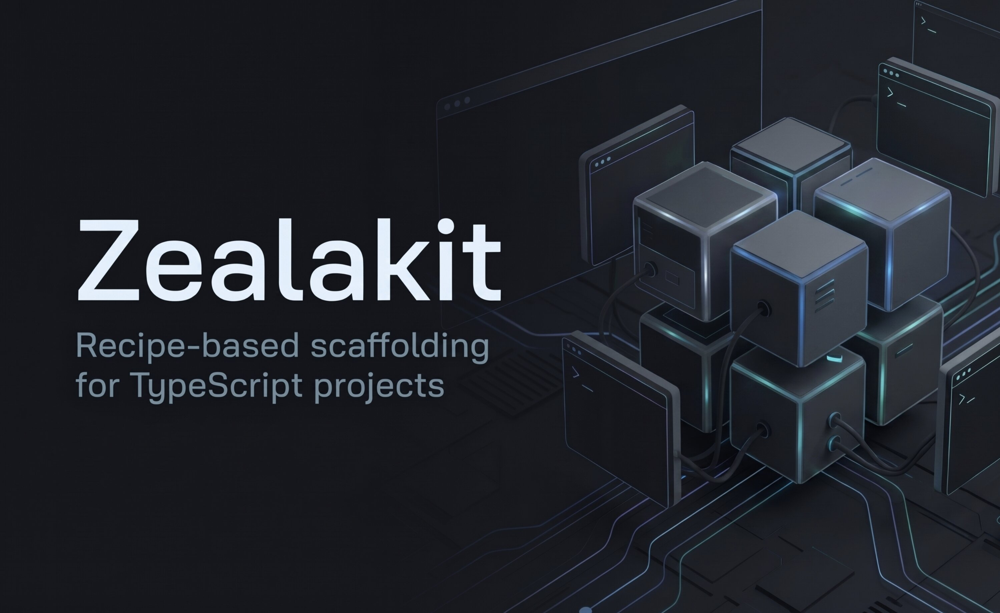

# Zealakit

<p align="center">
  
</p>

**Recipe-based scaffolding for multi-ecosystem projects.**

Pick a template, add only the recipes you need, and get a ready-to-install project — dependencies, scripts, and AI-agent docs included. No global install required.

[English](https://github.com/zealakit/zealakit/blob/main/README.md) · [Tiếng Việt](https://github.com/zealakit/zealakit/blob/main/README_VI.md) · [中文](https://github.com/zealakit/zealakit/blob/main/README_CN.md)

---

## Install

No global install is required — run the CLI with `npx`:

```bash
npx zealakit@latest create
```

Or install it globally:

```bash
npm install --global zealakit
```

Node.js 22.12+ is required for the CLI (see [Requirements](#requirements)).

---

## Why Zealakit?

Most starters are either empty or overloaded. Zealakit lets you compose:

1. **Template** — Vite + React, Vite + Vue, SvelteKit, Astro + React (client or hybrid), Next.js, Nuxt, NestJS, Hono, or Go API/worker starters
2. **Recipes** — optional layers (Biome, Zustand, shadcn/ui, Drizzle, Storybook, …)

Each recipe brings files, packages, scripts, and agent guidance when relevant. The result is a normal standalone project — use `npm`, `pnpm`, `yarn`, or `bun`.

---

## Requirements

- **Node.js 22.12+** for the CLI. The Nuxt template requires Node.js 22.22+.
- **Go 1.22+** for Go templates (optional; TypeScript workflows work without it).

---

## Quick start

```bash
# Interactive (manual template pick, or Project Discovery)
npx zealakit@latest create

# Discover a suitable setup from your requirements
npx zealakit@latest create --discover

# Create from a specific template
npx zealakit@latest create --template next
```

After generation:

```bash
cd my-app
npm install
npm run dev
```

### Non-interactive

```bash
npx zealakit@latest create my-app -t next -w oxc,shadcn-ui,storybook -y
npx zealakit@latest create api -t nest -w oxc,drizzle-orm -y
```

### Preview without writing

```bash
npx zealakit@latest create my-app -t next -w oxc,shadcn-ui,storybook --dry-run
```

- Without `-w` / `-y`, the CLI is interactive.
- `-y` needs a project name and skips confirmation prompts.
- Root `npx zealakit@latest my-app …` still works for backward compatibility.

---

## Project Discovery

**Project Discovery** is designed for product intent first — including non-technical builders using AI-assisted development. Questions ask what you want the product to do (kind of website, visitor actions, whether data is saved, who uses a service), not SPA/SSR jargon, ORM choice, or architecture levels.

Zealakit converts those answers into technical requirements internally, then recommends a template and only the recipes that fit. You review and can change anything before files are written.

Use Discovery when you are unsure which starter matches your needs. Prefer `--template` when you already know the stack.

```bash
npx zealakit@latest create --discover
```

### Project types

| Type                      | Status      | Typical follow-ups (plain language)                                                                                     |
| ------------------------- | ----------- | ----------------------------------------------------------------------------------------------------------------------- |
| **UI / Website**          | Supported   | Kind of website, what visitors can do, accounts/data when relevant, how often content changes, optional tech preference |
| **Backend / API Service** | Supported   | What the service does, who uses it, storage needs, sign-in when relevant, optional TypeScript or Go                     |
| **Background / Worker**   | Supported   | What runs in the background, when it runs, data needs, optional TypeScript or Go                                        |
| **Complete Product**      | Coming soon | Entire product (simple site through multi-service systems) — **not** recommendable or generatable yet                   |

Questions from other branches are never shown. Changing the root project type clears incompatible answers. Progress counts only the active branch.

**Not sure** / **Recommend for me** / **No preference** means “skip this preference” — it does not invent hard constraints.

**External API vs generated backend:** saying your website talks to an API you already have marks _external API consumption_. That does **not** make Zealakit generate a backend. Saving data in a new UI project can require a data-capable (hybrid) starter instead of a frontend-only one.

Unsupported combinations (for example TypeScript workers, NoSQL) yield **no compatible template** with a clear explanation, rather than a misleading fallback.

How it works:

1. Choose what to create (UI / Website, Backend / API Service, or Background / Worker).
2. Answer branch-specific intent questions (only what applies).
3. Zealakit resolves technical requirements, then ranks **compatible** templates with short explanations (incompatible starters are hidden).
4. Review suggested recipes — nothing unnecessary is pre-selected.
5. Confirm the recommended setup (or go back to adjust answers / template / recipes).
6. **Name the project** only after you accept a setup (naming does not re-run matching).
7. Generation uses the same scaffolding pipeline as manual create.

You always keep control: Discovery never installs a template or recipe you did not accept at the confirmation step.

### Local Discovery feedback

Completed Discovery sessions can write a **local-only** summary so you can spot recommendation gaps over time. Nothing is uploaded; there is no cloud analytics.

**Recorded (IDs and flags only):** session status, recommended/selected template and recipe IDs, whether you changed the initial recommendations, generation success/failure, and duration when available.

**Never recorded:** project source, file contents, environment variables, credentials, personal data, absolute project paths, or raw questionnaire answers.

| Command                               | Purpose                                                             |
| ------------------------------------- | ------------------------------------------------------------------- |
| `zealakit discovery stats`            | Offline summary (counts, top templates/recipes, diagnostic signals) |
| `zealakit discovery feedback status`  | Whether collection is on and where data is stored                   |
| `zealakit discovery feedback disable` | Stop collecting new sessions (existing stats stay readable)         |
| `zealakit discovery feedback enable`  | Re-enable collection                                                |
| `zealakit discovery feedback clear`   | Delete retained session records                                     |

Storage: `~/.config/zealakit/discovery-feedback.json` (or `%APPDATA%\zealakit\` on Windows; override with `ZEALAKIT_CONFIG_DIR`). At most 100 sessions are kept. You can also disable via `ZEALAKIT_DISCOVERY_FEEDBACK=0`. Feedback write failures never block project generation.

Diagnostic signals from `discovery stats` are hints only — they do **not** auto-tune matching weights.

---

## Commands

```text
npx zealakit@latest create [project-name] [options]
```

| Option                       | Description                                                                                                           |
| ---------------------------- | --------------------------------------------------------------------------------------------------------------------- |
| `--discover`                 | Project Discovery — recommend a template/recipes from your requirements                                               |
| `-t, --template <id>`        | Choose a base template yourself (default: `vite-react`)                                                               |
| `-w, --with <recipes>`       | Comma-separated recipe IDs (e.g. `biome,zustand`)                                                                     |
| `-y, --yes`                  | Non-interactive; refuses a non-empty target (needs a project name)                                                    |
| `--force`                    | Overwrite a non-empty target directory without asking                                                                 |
| `--pm <manager>`             | `npm`, `pnpm`, `yarn` or `bun` for install and next steps (default: detected)                                         |
| `--install` / `--no-install` | Install dependencies after generating (`go mod tidy` for Go). Asked when interactive; off with `-y`                   |
| `--git` / `--no-git`         | `git init` and an initial commit. Asked when interactive; off with `-y`                                               |
| `--no-manifest`              | Do not write `zealakit.json` into the project                                                                         |
| `--preset <name>`            | Apply a saved preset; explicit flags override it                                                                      |
| `--save-preset <name>`       | Save the chosen template and recipes as a user preset                                                                 |
| `--json`                     | Non-interactive only (needs `-y`, `-w`, `--preset` or `--dry-run`): one JSON result on stdout, human output on stderr |
| `--dry-run`                  | Preview the plan without writing files                                                                                |
| `-h, --help`                 | Show help                                                                                                             |
| `-V, --version`              | Show version                                                                                                          |

### `zealakit add`

Add recipes to a project you already generated (it needs `zealakit.json`):

```bash
zealakit add zustand tanstack-query          # preview the diff, then confirm
zealakit add vitest --dry-run                # preview only
zealakit add github-actions -y --json        # non-interactive, machine-readable
```

`add` regenerates the project with the installed kit, with and without the new recipes, and applies only the difference — so a pristine project ends up identical to `create -w <all recipes>`. Dependencies and scripts are merged into your `package.json`; agent docs get the new entries inserted. Files you edited are **never silently overwritten**: they are listed as conflicts with the kit's patch to apply by hand (or pass `--overwrite-files`; originals are backed up and restored on failure). It refuses to run on a dirty git tree unless you pass `--force`. Options: `--cwd`, `--dry-run`, `-y`, `--force`, `--overwrite-files`, `--install`, `--pm`, `--json`.

### External recipes, stacks and agents

- **External recipes** — `-w ./my-recipe` or `-w github:owner/repo/path#ref`; data-only, confirmed before use. See [`docs/external-recipes.md`](https://github.com/zealakit/zealakit/blob/main/docs/external-recipes.md); author them with `zealakit recipe init|validate`.
- **Stacks** — one workspace, several apps: `zealakit create shop --stack web=next,api=hono -w web:mui,api:biome -y` creates `apps/web`, `apps/api` (each a normal zealakit project), `packages/contracts` and a root `zealakit.json` with `schemaVersion: 2`. Use `zealakit add <recipe> --app web`; `doctor` and `outdated` cover every app. Node templates only; root-level recipes and Discovery stack recommendations are not available yet.
- **MCP** — `zealakit mcp --root <dir>` lets AI agents plan/create/add with confirmation gates. See [`docs/mcp.md`](https://github.com/zealakit/zealakit/blob/main/docs/mcp.md).
- **Programmatic API** — `import { createZealakit } from "zealakit/api"`; see [`docs/programmatic-api.md`](https://github.com/zealakit/zealakit/blob/main/docs/programmatic-api.md).

The old root form `zealakit [name] -t …` has been **removed**: use `zealakit create`.

### `zealakit outdated`

Compares the dependency ranges your project got from its template and recipes with what the installed kit would write today (`package | project | kit | source | status`, or `--json`), and tells you when the project was generated by an older kit. Report only: it never edits your files.

### `zealakit doctor` in a project

Run it inside a generated project (or with `--cwd`) to also check `zealakit.json`, the kit version, the `.cursor → .agents` link, missing recipe files, `.env` against `.env.example`, and installed dependencies. Failures exit `3`; warnings do not.

### Metadata queries (`zealakit info`)

`zealakit info` prints templates, recipes, ecosystems, categories, and the compatibility rules from the registry. `--json` returns one versioned envelope (`schemaVersion: 4`, `command: "info"`, `filters`, `data`) for external UIs and integrations.

```bash
zealakit info --json --ecosystem node
zealakit info --json --scope server
zealakit info --json --template nest
zealakit info --json --recipe biome
zealakit info --json --category orm
zealakit info --json --discover --scope server
```

Filters combine with AND semantics; unknown values exit `2` with diagnostics on stderr and no JSON on stdout. The same filters also narrow the human-readable summary. `--discover` only adds Discovery profiles (`templates[].discovery`, `recipes[].discovery`) and keeps Discovery-eligible entries — it never asks questions, runs scoring, or scaffolds. Full contract: [docs/metadata-query-layer.md](https://github.com/zealakit/zealakit/blob/main/docs/internal/metadata-query-layer.md).

Python templates are managed with [uv](https://docs.astral.sh/uv/) (`uv sync`, `uv run …`); `zealakit doctor` reports whether it is installed, and `--install` runs `uv sync`. Python templates are not part of the Discovery questionnaire yet; choose them with `-t fastapi-api` / `-t python-worker`.

Other commands: `zealakit add`, `zealakit preset`, `zealakit info`, `zealakit doctor`, `zealakit discovery stats`, `zealakit discovery feedback`.

**Rules**

- `--discover` cannot be combined with `--template`, `-w`, `-y`, or `--dry-run` (Discovery is interactive).
- Project names follow npm naming (lowercase, no spaces).
- Existing non-empty folders ask before overwrite; with `-y` they are rejected.
- Invalid or conflicting recipes are rejected **before** any files are written.
- Generation stages into a temp directory, validates the result, then commits — a failed run does not leave a half-written new project.
- `--dry-run` uses the same resolution and validation as a real run (including default recipes and `dependsOn`), prints a preview, and exits `0` when ready or `3` when blocked.
- Exit codes: `0` success or cancel, `2` invalid usage, `3` validation/compatibility failure, `1` unexpected error.

---

## Configuration

### `zealakit.json`

Every generated project records how it was made (`kitVersion`, `template`, resolved `recipes`, the `requestedRecipes`, `createdAt`). Its schema ships in the package (`schema/zealakit.schema.json`). Disable it with `--no-manifest`.

An install or git failure never fails the scaffold: the project is already on disk, a warning is printed, and the exit code stays `0`.

### Presets

```bash
zealakit preset save team-next -t next -w biome,zustand --pm pnpm
zealakit create my-app --preset team-next
zealakit preset list        # also reads ./zealakit.config.json: { "presets": { … } }
```

Config lives in `~/.config/zealakit/config.json` (`$ZEALAKIT_CONFIG_DIR` overrides the folder), `./zealakit.config.json`, and any file passed with `--config <file>`; later ones win. Besides `presets`, a config can set `defaults` for every `create`:

```json
{
  "defaults": { "pm": "pnpm", "git": true, "install": true },
  "presets": {
    "team-next": { "template": "next", "recipes": ["biome", "mui", "vitest", "github-actions"] }
  }
}
```

Interactive runs end with "Save these choices as a preset?" (default no). The older `presets.json` is still read.

The CLI surface, JSON outputs and `zealakit.json` are pinned by contract tests and JSON Schemas in `schema/` — see [`docs/stability.md`](https://github.com/zealakit/zealakit/blob/main/docs/stability.md).

---

## Templates

| ID                   | Kind       | Stack                              | Dev command                                          |
| -------------------- | ---------- | ---------------------------------- | ---------------------------------------------------- |
| `vite-react`         | Client     | Vite + React + TypeScript          | `npm run dev`                                        |
| `vite-vue`           | Client     | Vite + Vue + TypeScript            | `npm run dev`                                        |
| `vite-svelte`        | Client     | SvelteKit SPA + Svelte 5 + TS      | `npm run dev`                                        |
| `astro-react-client` | Client/SSG | Astro + React islands + TypeScript | `npm run dev`                                        |
| `astro-react-hybrid` | Hybrid     | Astro + React SSR / Actions / ORM  | `npm run dev`                                        |
| `next`               | Hybrid     | Next.js App Router + TypeScript    | `npm run dev`                                        |
| `nuxt`               | Hybrid     | Nuxt + TypeScript                  | `npm run dev`                                        |
| `nest`               | Server     | NestJS + TypeScript                | `npm run start:dev`                                  |
| `hono`               | Server     | Hono + TypeScript                  | `npm run dev`                                        |
| `stdlib-api`         | Server     | Go HTTP API (stdlib)               | `make run`                                           |
| `gin-api`            | Server     | Go HTTP API (Gin)                  | `make run`                                           |
| `stdlib-worker`      | Infra      | Go background worker (stdlib)      | `make run`                                           |
| `fastapi-api`        | Server     | FastAPI + uv + pytest + ruff       | `uv run uvicorn app.main:app --reload --app-dir src` |
| `python-worker`      | Infra      | Python asyncio worker (uv)         | `uv run python -m app.main`                          |

Every Node project includes TypeScript, path aliases, and agent docs (`.agents/`, `AGENTS.md`). Go templates ship agent docs and Makefiles; Go recipes include PostgreSQL (`database/sql` + pgx), MySQL (`database/sql` + go-sql-driver/mysql), and MongoDB (official Go Driver v2).

---

## Recipes

Choose **at most one** recipe per exclusive category (linter, state, UI kit, HTTP client, ORM, …).

Exceptions:

- **`storybook`**, **`vitest`**, **`tanstack-query`**, **`docker`** — non-exclusive; combine with anything compatible (`tanstack-query` also sits beside Ky/Axios)
- **`client-shared-pieces`** — added automatically on Vite, Astro, Next, and Nuxt

| Recipe                  | Category       | Templates                               | Adds                                                        |
| ----------------------- | -------------- | --------------------------------------- | ----------------------------------------------------------- |
| `oxc`                   | Linter         | All                                     | Oxlint + Oxfmt (fast lint + format)                         |
| `biome`                 | Linter         | All                                     | Lint + format scripts                                       |
| `eslint`                | Linter         | All                                     | ESLint flat config                                          |
| `zustand`               | State          | Vite React, Astro, Next                 | Zustand store example                                       |
| `pinia`                 | State          | Vite Vue, Nuxt                          | Pinia store example                                         |
| `nanostores`            | State          | Vite, Astro, Next, Nuxt                 | Nanostores example                                          |
| `hookform-zod`          | Forms          | Vite React, Astro, Next                 | React Hook Form + Zod                                       |
| `vee-validate-zod`      | Forms          | Vite Vue, Nuxt                          | VeeValidate + Zod                                           |
| `kyjs`                  | HTTP           | Vite, Astro, Next, Nuxt                 | Ky client                                                   |
| `axios`                 | HTTP           | Vite, Astro, Next, Nuxt                 | Axios client                                                |
| `antd`                  | UI             | Vite React, Astro, Next                 | Ant Design setup                                            |
| `mui`                   | UI             | Vite React, Astro, Next                 | MUI setup                                                   |
| `shadcn-ui`             | UI             | Vite React, Astro, Next                 | Tailwind + shadcn/ui                                        |
| `shadcn-vue`            | UI             | Vite Vue, Nuxt                          | Tailwind + shadcn-vue                                       |
| `nuxt-ui`               | UI             | Vite Vue, Nuxt                          | Tailwind + Nuxt UI                                          |
| `storybook`             | Docs / testing | Vite, Astro, Next, Nuxt                 | Storybook config + scripts                                  |
| `docs`                  | Documentation  | All Node templates                      | Agent-ready README workflow + `docs:check`                  |
| `docs-go`               | Documentation  | Go templates                            | Agent-ready README workflow (`repo-docs` skill)             |
| `docs-python`           | Documentation  | Python templates                        | Agent-ready README workflow (`repo-docs` skill)             |
| `vitest`                | Testing        | Vite, Astro, Next, Nuxt                 | Vitest + Testing Library, sample test                       |
| `tanstack-query`        | Data fetching  | Vite React/Vue/Svelte, Next, Nuxt       | Query provider + example hook                               |
| `better-auth`           | Auth           | Next, Nuxt, Hono, Astro hybrid          | Better Auth server + client + route handler                 |
| `nest-auth`             | Auth           | Nest                                    | JWT login endpoint + bearer-token guard                     |
| `github-actions`        | CI             | All Node templates                      | CI workflow from your other recipes                         |
| `docker`                | Infrastructure | Nest, Hono, Next, Nuxt                  | Dockerfile + compose (db service with an ORM)               |
| `type-orm`              | ORM            | Nest, Hono, Next, Nuxt, Astro hybrid    | TypeORM wiring + agent skill                                |
| `mikro-orm`             | ORM            | Nest, Hono, Next, Nuxt, Astro hybrid    | MikroORM wiring + agent skill                               |
| `drizzle-orm`           | ORM            | Nest, Hono, Next, Nuxt, Astro hybrid    | Drizzle + drizzle-kit scripts                               |
| `prisma`                | ORM            | Nest, Hono, Next, Nuxt, Astro hybrid    | Prisma schema + migrate scripts                             |
| `postgres`              | Database       | Go templates                            | `database/sql` + pgx driver                                 |
| `mysql`                 | Database       | Go templates                            | `database/sql` + MySQL driver                               |
| `mongodb`               | Database       | Go templates                            | Official MongoDB Go Driver v2                               |
| `docker-go`             | Infrastructure | Go templates                            | Dockerfile + compose (db service with a database recipe)    |
| `sqlalchemy`            | ORM            | FastAPI                                 | SQLAlchemy 2 + repository adapter (SQLite default)          |
| `alembic`               | Migrations     | FastAPI (needs `sqlalchemy`)            | Alembic config + first migration                            |
| `postgres-python`       | Infrastructure | Python templates                        | psycopg 3 + `DATABASE_URL`                                  |
| `docker-python`         | Infrastructure | Python templates                        | uv Dockerfile + compose (db service with `postgres-python`) |
| `github-actions-python` | CI             | Python templates                        | `uv sync`, ruff, pytest workflow                            |
| `github-actions-go`     | CI             | Go templates                            | `go vet` / `go test` / `go build` workflow                  |
| `goose`                 | Migrations     | Go templates (needs `postgres`/`mysql`) | Embedded SQL migrations + `cmd/migrate`                     |
| `sqlc`                  | ORM            | Go templates (needs `postgres`/`mysql`) | `sqlc.yaml` + example queries                               |
| `redis`                 | Infrastructure | Go templates                            | go-redis client + `REDIS_URL`                               |

ORM recipes are driver-agnostic. After scaffolding, install your DB driver (`pg`, `mysql2`, …) and follow the skill under `.agents/skills/<orm>/`.

**Hybrid caveat:** ORM on Next, Nuxt, Astro hybrid, etc. is best-effort for **small** apps — not as strong as a dedicated backend framework. Prefer a backend framework for production APIs. The CLI warns in interactive mode and `--dry-run`.

### Examples

```bash
# SPA: Biome, Zustand, forms, Ky
npx zealakit@latest web -t vite-react -w biome,zustand,hookform-zod,kyjs -y

# Vue SPA: Biome, Pinia, VeeValidate, Ky, shadcn-vue
npx zealakit@latest web-vue -t vite-vue -w biome,pinia,vee-validate-zod,kyjs,shadcn-vue -y

# Nuxt: Biome, Pinia, VeeValidate, Ky, Nuxt UI
npx zealakit@latest web-nuxt -t nuxt -w biome,pinia,vee-validate-zod,kyjs,nuxt-ui -y

# Next.js: shadcn/ui + Storybook
npx zealakit@latest next-web -t next -w biome,shadcn-ui,storybook -y

# Astro + React islands: Biome + shadcn/ui
npx zealakit@latest my-astro-app -t astro-react-client -w biome,shadcn-ui -y

# Astro hybrid (SSR + optional ORM): Biome + Drizzle
npx zealakit@latest my-astro-hybrid -t astro-react-hybrid -w biome,drizzle-orm -y

# Nest API: Drizzle
npx zealakit@latest api-nest -t nest -w biome,drizzle-orm -y

# Hono API: TypeORM
npx zealakit@latest api-hono -t hono -w biome,type-orm -y
```

---

## After scaffolding

```text
my-app/
├─ src/
├─ .agents/          # Skills & rules for coding agents
├─ AGENTS.md
├─ package.json
└─ …
```

Zealakit only runs at create time. The output is a normal app with no runtime dependency on Zealakit, and no forced package manager.

Install and start with your preferred client:

```bash
cd my-app
npm install && npm run dev
# or: pnpm install && pnpm dev
# or: yarn && yarn dev
# or: bun install && bun run dev
```

---

## FAQ

**Does Zealakit install dependencies?**  
No. It writes the project; you install with your package manager.

**Can I pick two linters, state libraries, or UI kits?**  
No — those categories are exclusive. Storybook is the exception.

**Can I edit the generated code?**  
Yes. Treat it like any other project.

**Monorepos?**  
Not yet. Each run creates one standalone project.

---

## Exit codes

| Code | Meaning                                                      |
| ---- | ------------------------------------------------------------ |
| `0`  | Success, or the user cancelled an interactive prompt         |
| `1`  | Unexpected internal error                                    |
| `2`  | Invalid usage (unknown flag, bad value, conflicting recipes) |
| `3`  | Validation, compatibility or project-check failure           |

Exit codes are part of the stability contract — see [`docs/stability.md`](https://github.com/zealakit/zealakit/blob/main/docs/stability.md).

---

## License

[MIT](https://github.com/zealakit/zealakit/blob/main/LICENSE)

Source: [github.com/zealakit/zealakit](https://github.com/zealakit/zealakit) · [Issues](https://github.com/zealakit/zealakit/issues)
