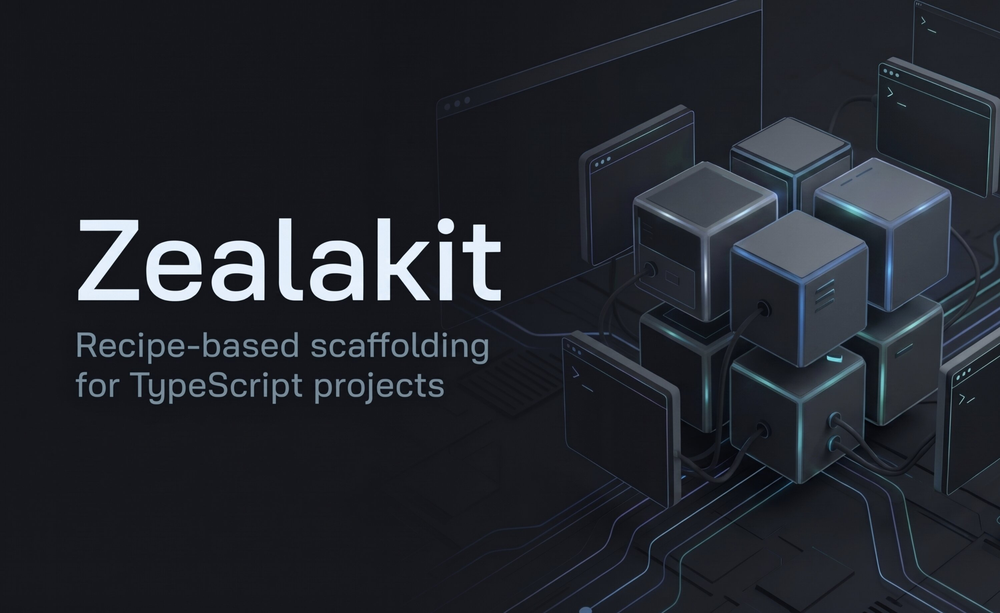

# Zealakit

<p align="center">
  
</p>

**基于 Recipe 的 TypeScript 项目脚手架。**

选择模板，只叠加需要的 Recipe，即可得到可直接安装的项目——包含依赖、脚本和 AI Agent 文档。无需全局安装 CLI。

[English](https://github.com/zealakit/zealakit/blob/main/README.md) · [Tiếng Việt](https://github.com/zealakit/zealakit/blob/main/README_VI.md) · [中文](https://github.com/zealakit/zealakit/blob/main/README_CN.md)

```bash
npx zealakit@latest create
```

---

## 为什么用 Zealakit？

常见 starter 要么太空，要么塞满用不到的东西。Zealakit 让你自由组合：

1. **模板（Template）** — Vite + React、Vite + Vue、Astro + React（client 或 hybrid）、Next.js、Nuxt、NestJS、Hono，或 Go API/worker starter
2. **配方（Recipe）** — 可选层（Biome、Zustand、shadcn/ui、Drizzle、Storybook 等）

每个 Recipe 会带上对应的文件、包、脚本，以及（如有）Agent 指引。结果是一个普通的独立项目——可用 `npm`、`pnpm`、`yarn` 或 `bun`。

---

## 环境要求

- **Node.js 18+**

---

## 快速开始

```bash
# 交互式（手动选模板，或 Project Discovery）
npx zealakit@latest create

# 根据需求发现合适的 setup
npx zealakit@latest create --discover

# 从指定模板创建
npx zealakit@latest create --template next
```

生成之后：

```bash
cd my-app
npm install
npm run dev
```

### 非交互模式

```bash
npx zealakit@latest create my-app -t next -w biome,shadcn-ui,storybook -y
npx zealakit@latest create api -t nest -w biome,drizzle-orm -y
```

### 预览（不写入）

```bash
npx zealakit@latest create my-app -t next -w biome,shadcn-ui,storybook --dry-run
```

- 不带 `-w` / `-y` 时进入交互流程。
- `-y` 必须提供项目名，并跳过确认。
- 根命令 `npx zealakit@latest my-app …` 仍可用于向后兼容。

---

## Project Discovery

**Project Discovery** 会询问你在做什么，然后推荐合适的模板以及匹配的 Recipe。写入文件前你可以随时调整选择。

不确定该用哪个 starter 时用 Discovery；已经明确技术栈时优先用 `--template`。

```bash
npx zealakit@latest create --discover
```

流程：

1. 回答简短问题（项目类型、可选 UI/runtime 偏好、数据库等 extras）。
2. 查看按匹配度排序的**兼容**模板及简短说明（不兼容的会被隐藏）。
3. 查看建议的 Recipe——不会预选不必要的项。
4. 确认摘要（或返回调整答案 / 模板 / Recipe）。
5. 生成走与手动 create 相同的脚手架流水线。

你始终保有控制权：在确认步骤未接受的模板/Recipe，Discovery 不会安装。

### 本地 Discovery 反馈

完成的 Discovery 会话可写入**仅本地**摘要，便于长期发现推荐缺口。不会上传；没有云端 analytics。

**会记录（仅 ID 与标志）：** 会话状态、推荐/已选模板与 Recipe ID、是否改动了初始推荐、生成成功/失败，以及（如有）耗时。

**绝不记录：** 项目源码、文件内容、环境变量、凭证、个人数据、绝对路径，或问卷原始答案。

| 命令 | 用途 |
| --- | --- |
| `zealakit discovery stats` | 离线汇总（次数、常用模板/Recipe、诊断信号） |
| `zealakit discovery feedback status` | 是否开启及数据存放位置 |
| `zealakit discovery feedback disable` | 停止采集新会话（已有统计仍可读） |
| `zealakit discovery feedback enable` | 重新开启采集 |
| `zealakit discovery feedback clear` | 删除已保留的会话记录 |

存储位置：`~/.config/zealakit/discovery-feedback.json`（Windows 为 `%APPDATA%\zealakit\`；可用 `ZEALAKIT_CONFIG_DIR` 覆盖）。最多保留 100 条会话。也可通过 `ZEALAKIT_DISCOVERY_FEEDBACK=0` 关闭。反馈写入失败**不会**阻塞项目生成。

`discovery stats` 中的诊断信号仅供参考——**不会**自动调整匹配权重。

---

## CLI

```text
npx zealakit@latest create [项目名] [选项]
```

| 选项                   | 说明                                               |
| ---------------------- | -------------------------------------------------- |
| `--discover`           | Project Discovery — 根据需求推荐模板/Recipe        |
| `-t, --template <id>`  | 自行选择基础模板（默认：`vite-react`）             |
| `-w, --with <recipes>` | 逗号分隔的 Recipe ID（如 `biome,zustand`）         |
| `-y, --yes`            | 非交互模式（必须提供项目名）                       |
| `--dry-run`            | 预览生成计划，不写入文件                           |
| `-h, --help`           | 显示帮助                                           |
| `-V, --version`        | 显示版本                                           |

其他命令：`zealakit info`、`zealakit doctor`、`zealakit discovery stats`、`zealakit discovery feedback`。

**规则**

- `--discover` 不能与 `--template`、`-w`、`-y` 或 `--dry-run` 同时使用（Discovery 为交互式）。
- 项目名需符合 npm 规范（小写、无空格）。
- 目标目录非空时会先确认；使用 `-y` 时直接拒绝覆盖。
- 无效或冲突的 Recipe 会在**写入任何文件之前**被拒绝。
- 生成会先写入临时目录并校验，通过后再提交——失败时不会留下半成品的新项目。
- `--dry-run` 使用与真实生成相同的解析与校验（含默认 Recipe 与 `dependsOn`），打印预览；就绪时退出码 `0`，被阻止时为 `3`。
- 退出码：`0` 成功或取消，`2` 用法错误，`3` 校验/兼容失败，`1` 意外错误。

---

## 模板

| ID                   | 类型       | 技术栈                             | 开发命令            |
| -------------------- | ---------- | ---------------------------------- | ------------------- |
| `vite-react`         | 客户端     | Vite + React + TypeScript          | `npm run dev`       |
| `vite-vue`           | 客户端     | Vite + Vue + TypeScript            | `npm run dev`       |
| `astro-react-client` | 客户端/SSG | Astro + React islands + TypeScript | `npm run dev`       |
| `astro-react-hybrid` | 混合       | Astro + React SSR / Actions / ORM  | `npm run dev`       |
| `next`               | 混合       | Next.js App Router + TypeScript    | `npm run dev`       |
| `nuxt`               | 混合       | Nuxt + TypeScript                  | `npm run dev`       |
| `nest`               | 服务端     | NestJS + TypeScript                | `npm run start:dev` |
| `hono`               | 服务端     | Hono + TypeScript                  | `npm run dev`       |
| `stdlib-api`         | 服务端     | Go HTTP API（stdlib）              | `make run`          |
| `gin-api`            | 服务端     | Go HTTP API（Gin）                 | `make run`          |
| `stdlib-worker`      | 基础设施   | Go 后台 worker（stdlib）           | `make run`          |

每个 Node 项目都包含 TypeScript、路径别名和 Agent 文档（`.agents/`、`AGENTS.md`）。Go 模板附带 Agent 文档与 Makefile。

---

## Recipe

每个互斥分类（linter、state、UI 套件、HTTP 客户端、ORM 等）最多选 **一个** Recipe。

例外：

- **`storybook`** — 可与 UI 套件同时使用
- **`client-shared-pieces`** — 在 Vite / Astro / Next / Nuxt 上自动添加

| Recipe             | 分类        | 适用模板                             | 内容                       |
| ------------------ | ----------- | ------------------------------------ | -------------------------- |
| `biome`            | Linter      | 全部                                 | Lint + Format 脚本         |
| `eslint`           | Linter      | 全部                                 | ESLint flat config         |
| `zustand`          | State       | Vite React、Astro、Next              | Zustand 示例               |
| `pinia`            | State       | Vite Vue、Nuxt                       | Pinia 示例                 |
| `nanostores`       | State       | Vite、Astro、Next、Nuxt              | Nanostores 示例            |
| `hookform-zod`     | Forms       | Vite React、Astro、Next              | React Hook Form + Zod      |
| `vee-validate-zod` | Forms       | Vite Vue、Nuxt                       | VeeValidate + Zod          |
| `kyjs`             | HTTP        | Vite、Astro、Next、Nuxt              | Ky 客户端                  |
| `axios`            | HTTP        | Vite、Astro、Next、Nuxt              | Axios 客户端               |
| `antd`             | UI          | Vite React、Astro、Next              | Ant Design                 |
| `mui`              | UI          | Vite React、Astro、Next              | MUI                        |
| `shadcn-ui`        | UI          | Vite React、Astro、Next              | Tailwind + shadcn/ui       |
| `shadcn-vue`       | UI          | Vite Vue、Nuxt                       | Tailwind + shadcn-vue      |
| `nuxt-ui`          | UI          | Vite Vue、Nuxt                       | Tailwind + Nuxt UI         |
| `storybook`        | 文档 / 测试 | Vite、Astro、Next、Nuxt              | Storybook 配置与脚本       |
| `type-orm`         | ORM         | Nest、Hono、Next、Nuxt、Astro hybrid | TypeORM + Agent skill      |
| `mikro-orm`        | ORM         | Nest、Hono、Next、Nuxt、Astro hybrid | MikroORM + Agent skill     |
| `drizzle-orm`      | ORM         | Nest、Hono、Next、Nuxt、Astro hybrid | Drizzle + drizzle-kit 脚本 |
| `prisma`           | ORM         | Nest、Hono、Next、Nuxt、Astro hybrid | Prisma schema + migrate    |

ORM Recipe 不绑定具体数据库驱动。脚手架完成后自行安装驱动（`pg`、`mysql2` 等），并参考 `.agents/skills/<orm>/` 中的说明。

**Hybrid 注意：** Next、Nuxt、Astro hybrid 等上的 ORM 仅适合**小型**项目，不如纯后端框架完善。生产 API 请优先使用后端框架。交互模式与 `--dry-run` 会给出警告。

### 示例

```bash
# SPA：Biome、Zustand、表单、Ky
npx zealakit@latest web -t vite-react -w biome,zustand,hookform-zod,kyjs -y

# Vue SPA：Biome、Pinia、VeeValidate、Ky、shadcn-vue
npx zealakit@latest web-vue -t vite-vue -w biome,pinia,vee-validate-zod,kyjs,shadcn-vue -y

# Nuxt：Biome、Pinia、VeeValidate、Ky、Nuxt UI
npx zealakit@latest web-nuxt -t nuxt -w biome,pinia,vee-validate-zod,kyjs,nuxt-ui -y

# Next.js：shadcn/ui + Storybook
npx zealakit@latest next-web -t next -w biome,shadcn-ui,storybook -y

# Astro + React islands：Biome + shadcn/ui
npx zealakit@latest my-astro-app -t astro-react-client -w biome,shadcn-ui -y

# Astro hybrid（SSR + 可选 ORM）：Biome + Drizzle
npx zealakit@latest my-astro-hybrid -t astro-react-hybrid -w biome,drizzle-orm -y

# Nest API：Drizzle
npx zealakit@latest api-nest -t nest -w biome,drizzle-orm -y

# Hono API：TypeORM
npx zealakit@latest api-hono -t hono -w biome,type-orm -y
```

---

## 脚手架之后

```text
my-app/
├─ src/
├─ .agents/          # 供 coding agent 使用的 skills / rules
├─ AGENTS.md
├─ package.json
└─ …
```

Zealakit 只在创建时使用。生成结果是普通应用，运行时不依赖 Zealakit，也不强制包管理器。

用你喜欢的客户端安装并启动：

```bash
cd my-app
npm install && npm run dev
# 或：pnpm install && pnpm dev
# 或：yarn && yarn dev
# 或：bun install && bun run dev
```

---

## 常见问题

**Zealakit 会安装依赖吗？**  
不会。它只写入项目文件；请自行用包管理器安装。

**可以同时选两个 linter / state / UI 套件吗？**  
不可以——这些分类互斥。Storybook 除外。

**可以修改生成的代码吗？**  
可以。把它当作普通项目即可。

**支持 monorepo 吗？**  
暂不支持。每次运行创建一个独立项目。

---

## 工具用元数据

```bash
npx zealakit@latest info --json   # 别名：zealakit --info --json
```

在 stdout 上只输出一个 JSON 文档（不含其他内容）：CLI 名称/版本、模板（含交互流程和默认 recipe）、分类、recipe（兼容模板、冲突、依赖包）以及兼容性规则。键均为固定 id；仅在不兼容变更时才会修改 `schemaVersion`。不加 `--json` 时输出便于阅读的摘要。

---

## 仓库结构

本仓库为 pnpm monorepo。发布到 npm 的包仍是 **`zealakit`**（根包）；workspace 包为 private，并打包进 `dist/`。

```text
apps/cli/                   # CLI 入口（prompts、flags、UX、doctor）
packages/core/              # 与生态无关的脚手架引擎
packages/ecosystem-node/    # Node 注册表 + npm package.json 适配器
packages/ecosystem-go/      # 可选 Go 工具链检测
templates/node/<id>/        # Node 基础模板
templates/go/stdlib-api/    # Go stdlib HTTP API 模板
templates/go/gin-api/       # Go Gin HTTP API 模板
templates/go/stdlib-worker/ # Go stdlib 后台 worker
recipes/node/<id>/          # Node Recipe
recipes/go/                 # 预留（尚无 Go Recipe）
```

检查运行环境（Go 可选；没有 Go 也可跑 TypeScript 工作流）：

```bash
npx zealakit@latest doctor
npx zealakit@latest doctor --json
```

---

## 许可证

[MIT](LICENSE)

源码：[github.com/zealakit/zealakit](https://github.com/zealakit/zealakit)
