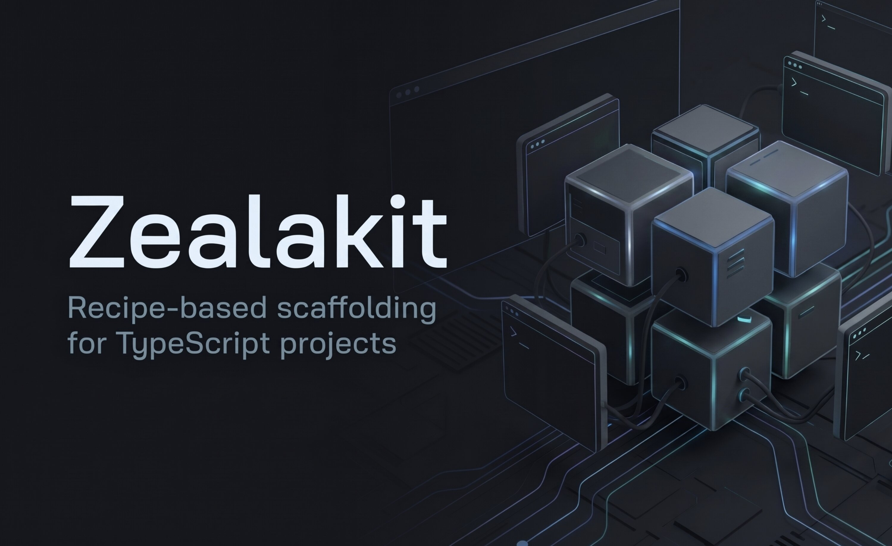

# Zealakit

<p align="center">
  
</p>

**基于 Recipe 的多生态项目脚手架。**

选择模板，只叠加需要的 Recipe，即可得到可直接安装的项目——包含依赖、脚本和 AI Agent 文档。无需全局安装 CLI。

[English](https://github.com/zealakit/zealakit/blob/main/README.md) · [Tiếng Việt](https://github.com/zealakit/zealakit/blob/main/README_VI.md) · [中文](https://github.com/zealakit/zealakit/blob/main/README_CN.md)

---

## 安装

无需全局安装——用 `npx` 直接运行 CLI：

```bash
npx zealakit@latest create
```

或全局安装：

```bash
npm install --global zealakit
```

CLI 需要 Node.js 22.12+（见 [环境要求](#环境要求)）。

---

## 为什么用 Zealakit？

常见 starter 要么太空，要么塞满用不到的东西。Zealakit 让你自由组合：

1. **模板（Template）** — Vite + React、Vite + Vue、SvelteKit、Astro + React（client 或 hybrid）、Next.js、Nuxt、NestJS、Hono，或 Go API/worker starter
2. **配方（Recipe）** — 可选层（Biome、Zustand、shadcn/ui、Drizzle、Storybook 等）

每个 Recipe 会带上对应的文件、包、脚本，以及（如有）Agent 指引。结果是一个普通的独立项目——可用 `npm`、`pnpm`、`yarn` 或 `bun`。

---

## 环境要求

- **Node.js 22.12+**（CLI）。Nuxt 模板需要 Node.js 22.22+。
- Go 模板需要 **Go 1.22+**（可选；TypeScript 工作流无需 Go）。

---

## 快速开始

```bash
# 交互式（手动选模板，或 Project Discovery）
npx zealakit@latest create

# 根据需求发现合适的 setup
npx zealakit@latest create --discover

# 从指定模板创建
npx zealakit@latest create --template next
```

生成之后：

```bash
cd my-app
npm install
npm run dev
```

### 非交互模式

```bash
npx zealakit@latest create my-app -t next -w biome,shadcn-ui,storybook -y
npx zealakit@latest create api -t nest -w biome,drizzle-orm -y
```

### 预览（不写入）

```bash
npx zealakit@latest create my-app -t next -w biome,shadcn-ui,storybook --dry-run
```

- 不带 `-w` / `-y` 时进入交互流程。
- `-y` 必须提供项目名，并跳过确认。
- 根命令 `npx zealakit@latest my-app …` 仍可用于向后兼容。

---

## Project Discovery

**Project Discovery** 以产品意图为先——也面向用 AI 辅助开发的非技术用户。问题询问你想让产品做什么（网站类型、访客能做什么、是否保存数据、谁会使用服务），而不是 SPA/SSR 术语、ORM 选择或架构层级。

Zealakit 在内部把这些答案解析为技术需求，再推荐模板与匹配的 Recipe。写入文件前你可以随时调整。

不确定该用哪个 starter 时用 Discovery；已经明确技术栈时优先用 `--template`。

```bash
npx zealakit@latest create --discover
```

### 项目类型

| 类型                      | 状态     | 典型后续问题（通俗表述）                                              |
| ------------------------- | -------- | --------------------------------------------------------------------- |
| **UI / Website**          | 已支持   | 网站类型、访客能力、在相关时询问账号/数据、内容更新频率、可选技术偏好 |
| **Backend / API Service** | 已支持   | 服务做什么、谁使用、存储需求、在相关时询问登录、可选 TypeScript 或 Go |
| **Background / Worker**   | 已支持   | 后台任务、何时运行、数据需求、可选 TypeScript 或 Go                   |
| **Complete Product**      | 即将推出 | 完整产品（从简单网站到多服务系统）——**尚不可**推荐或生成              |

不会展示其他分支的问题。更改根项目类型会清除不兼容的答案。进度只统计当前分支。

**Not sure** / **Recommend for me** / **No preference** 表示跳过该偏好——不会虚构硬性约束。

**已有 API vs 由 Zealakit 生成后端：** 若网站对接你已有的 API，这表示*消费外部 API*，**不会**让 Zealakit 生成后端。新 UI 需要持久化数据时，可能需要具备数据能力的 hybrid starter，而不是纯前端模板。

尚不支持的组合（如 TypeScript worker、NoSQL）会得到**无兼容模板**及清晰说明，而不是误导性回退。

流程：

1. 选择要创建的内容（UI / Website、Backend / API Service 或 Background / Worker）。
2. 回答分支相关的意图问题（仅适用项）。
3. Zealakit 解析技术需求，再按匹配度排序**兼容**模板及简短说明。
4. 查看建议的 Recipe——不会预选不必要的项。
5. 确认推荐配置（或返回调整）。
6. **仅在接受配置之后**再命名项目（命名不会重新跑 matching）。
7. 生成走与手动 create 相同的脚手架流水线。

你始终保有控制权：在确认步骤未接受的模板/Recipe，Discovery 不会安装。

### 本地 Discovery 反馈

完成的 Discovery 会话可写入**仅本地**摘要，便于长期发现推荐缺口。不会上传；没有云端 analytics。

**会记录（仅 ID 与标志）：** 会话状态、推荐/已选模板与 Recipe ID、是否改动了初始推荐、生成成功/失败，以及（如有）耗时。

**绝不记录：** 项目源码、文件内容、环境变量、凭证、个人数据、绝对路径，或问卷原始答案。

| 命令                                  | 用途                                        |
| ------------------------------------- | ------------------------------------------- |
| `zealakit discovery stats`            | 离线汇总（次数、常用模板/Recipe、诊断信号） |
| `zealakit discovery feedback status`  | 是否开启及数据存放位置                      |
| `zealakit discovery feedback disable` | 停止采集新会话（已有统计仍可读）            |
| `zealakit discovery feedback enable`  | 重新开启采集                                |
| `zealakit discovery feedback clear`   | 删除已保留的会话记录                        |

存储位置：`~/.config/zealakit/discovery-feedback.json`（Windows 为 `%APPDATA%\zealakit\`；可用 `ZEALAKIT_CONFIG_DIR` 覆盖）。最多保留 100 条会话。也可通过 `ZEALAKIT_DISCOVERY_FEEDBACK=0` 关闭。反馈写入失败**不会**阻塞项目生成。

`discovery stats` 中的诊断信号仅供参考——**不会**自动调整匹配权重。

---

## 命令

```text
npx zealakit@latest create [项目名] [选项]
```

| 选项                         | 说明                                                                                |
| ---------------------------- | ----------------------------------------------------------------------------------- |
| `--discover`                 | Project Discovery — 根据需求推荐模板/Recipe                                         |
| `-t, --template <id>`        | 自行选择基础模板（默认：`vite-react`）                                              |
| `-w, --with <recipes>`       | 逗号分隔的 Recipe ID（如 `biome,zustand`）                                          |
| `-y, --yes`                  | 非交互模式，目标目录非空时拒绝（必须提供项目名）                                    |
| `--force`                    | 无需确认，直接覆盖非空目标目录                                                      |
| `--pm <manager>`             | 安装与后续步骤使用的包管理器：`npm`、`pnpm`、`yarn`、`bun`（默认自动检测）          |
| `--install` / `--no-install` | 生成后安装依赖（Go 为 `go mod tidy`）。交互模式会询问；`-y` 时默认关闭              |
| `--git` / `--no-git`         | `git init` 并创建首个提交。交互模式会询问；`-y` 时默认关闭                          |
| `--no-manifest`              | 不在项目中写入 `zealakit.json`                                                      |
| `--preset <name>`            | 应用已保存的预设；显式参数优先                                                      |
| `--save-preset <name>`       | 将所选模板与 Recipe 保存为用户预设                                                  |
| `--json`                     | 仅限非交互（需要 `-y`、`-w`、`--preset` 或 `--dry-run`）：stdout 输出一个 JSON 结果 |
| `--dry-run`                  | 预览生成计划，不写入文件                                                            |
| `-h, --help`                 | 显示帮助                                                                            |
| `-V, --version`              | 显示版本                                                                            |

### `zealakit add`

向已生成的项目追加 Recipe（需要 `zealakit.json`）：

```bash
zealakit add zustand tanstack-query     # 预览 diff 后确认
zealakit add vitest --dry-run           # 仅预览
zealakit add github-actions -y --json   # 非交互，JSON 输出
```

`add` 用当前安装的 kit 分别生成「含/不含」新 Recipe 的项目，只应用差异——未改动的项目结果与 `create -w <全部 Recipe>` 完全一致。依赖与脚本会合并进 `package.json`；你编辑过的文件**不会被静默覆盖**（列为冲突并给出补丁，或使用 `--overwrite-files`，原文件会备份）。git 工作区不干净时拒绝执行，除非加 `--force`。在项目内运行 `zealakit doctor` 还会检查 manifest、`.cursor` 链接、Recipe 文件、`.env` 与依赖。

### 外部 Recipe、Stack、MCP 与 API

- **外部 Recipe**：`-w ./my-recipe` 或 `-w github:owner/repo/path#ref`——仅数据、不执行代码，使用前必须确认（非交互需 `--trust-external`）。见 [`docs/external-recipes.md`](https://github.com/zealakit/zealakit/blob/main/docs/external-recipes.md)；用 `zealakit recipe init|validate` 创建。
- **Stack**：`zealakit create shop --stack web=next,api=hono -w web:mui,api:biome -y` 创建含 `apps/web`、`apps/api`、`packages/contracts` 的工作区及 `schemaVersion: 2` 的 `zealakit.json`；用 `zealakit add <recipe> --app web` 追加。
- **MCP**：`zealakit mcp --root <dir>`（见 [`docs/mcp.md`](https://github.com/zealakit/zealakit/blob/main/docs/mcp.md)）；**API**：`import { createZealakit } from "zealakit/api"`。
- 旧的根命令形式 `zealakit [name] -t …` 已**移除**，请使用 `zealakit create`。

### `zealakit outdated`

`zealakit outdated` 将项目中（来自模板/Recipe）的依赖版本范围与当前安装的 kit 今天会写入的版本对比；仅报告，不改文件（`--json` 输出机器可读结果）。

### `zealakit doctor`

在生成的项目中运行（或使用 `--cwd`）会额外检查 `zealakit.json`、kit 版本、`.cursor → .agents` 链接、缺失的 Recipe 文件、`.env` 与 `.env.example` 以及已安装依赖。失败退出码为 `3`；警告不影响退出码。

### 元数据查询（`zealakit info`）

`zealakit info` 输出 registry 中的模板、Recipe、生态、分类和兼容规则。加上 `--json` 会返回带 `schemaVersion: 4` 的 envelope。

```bash
zealakit info --json --ecosystem node
zealakit info --json --scope server
zealakit info --json --template nest
zealakit info --json --recipe biome
```

过滤器使用 AND 组合；非法值会以退出码 `2` 结束，并且不会向 stdout 输出 JSON。

其他命令：`zealakit preset`、`zealakit info`、`zealakit doctor`、`zealakit discovery stats`、`zealakit discovery feedback`。

**规则**

- `--discover` 不能与 `--template`、`-w`、`-y` 或 `--dry-run` 同时使用（Discovery 为交互式）。
- 项目名需符合 npm 规范（小写、无空格）。
- 目标目录非空时会先确认；使用 `-y` 时直接拒绝覆盖。
- 无效或冲突的 Recipe 会在**写入任何文件之前**被拒绝。
- 生成会先写入临时目录并校验，通过后再提交——失败时不会留下半成品的新项目。
- `--dry-run` 使用与真实生成相同的解析与校验（含默认 Recipe 与 `dependsOn`），打印预览；就绪时退出码 `0`，被阻止时为 `3`。
- 退出码：`0` 成功或取消，`2` 用法错误，`3` 校验/兼容失败，`1` 意外错误。

---

## 配置

### `zealakit.json`

每个生成的项目都会写入 `zealakit.json`（`kitVersion`、`template`、解析后的 `recipes`、`requestedRecipes`、`createdAt`），其 schema 随包发布（`schema/zealakit.schema.json`），可用 `--no-manifest` 关闭。安装或 git 失败不会使生成失败（项目已写入，仅打印警告，退出码仍为 `0`）。

### 预设

```bash
zealakit preset save team-next -t next -w biome,zustand --pm pnpm
zealakit create my-app --preset team-next
zealakit preset list        # 还会读取 ./zealakit.config.json: { "presets": { … } }
```

用户预设位于 `~/.config/zealakit/presets.json`（`$ZEALAKIT_CONFIG_DIR` 可覆盖）；项目内 `zealakit.config.json` 同名时优先。除 `presets` 外，config 还可以为每次 `create` 设置 `defaults`：

```json
{
  "defaults": { "pm": "pnpm", "git": true, "install": true },
  "presets": {
    "team-next": { "template": "next", "recipes": ["biome", "mui", "vitest", "github-actions"] }
  }
}
```

CLI、JSON 输出与 `zealakit.json` 由契约测试和 `schema/` 中的 JSON Schema 固定——见 [`docs/stability.md`](https://github.com/zealakit/zealakit/blob/main/docs/stability.md)。

---

## 模板

| ID                   | 类型       | 技术栈                             | 开发命令                                             |
| -------------------- | ---------- | ---------------------------------- | ---------------------------------------------------- |
| `vite-react`         | 客户端     | Vite + React + TypeScript          | `npm run dev`                                        |
| `vite-vue`           | 客户端     | Vite + Vue + TypeScript            | `npm run dev`                                        |
| `vite-svelte`        | 客户端     | SvelteKit SPA + Svelte 5 + TS      | `npm run dev`                                        |
| `astro-react-client` | 客户端/SSG | Astro + React islands + TypeScript | `npm run dev`                                        |
| `astro-react-hybrid` | 混合       | Astro + React SSR / Actions / ORM  | `npm run dev`                                        |
| `next`               | 混合       | Next.js App Router + TypeScript    | `npm run dev`                                        |
| `nuxt`               | 混合       | Nuxt + TypeScript                  | `npm run dev`                                        |
| `nest`               | 服务端     | NestJS + TypeScript                | `npm run start:dev`                                  |
| `hono`               | 服务端     | Hono + TypeScript                  | `npm run dev`                                        |
| `stdlib-api`         | 服务端     | Go HTTP API（stdlib）              | `make run`                                           |
| `gin-api`            | 服务端     | Go HTTP API（Gin）                 | `make run`                                           |
| `fastapi-api`        | Server     | FastAPI + uv + pytest + ruff       | `uv run uvicorn app.main:app --reload --app-dir src` |
| `python-worker`      | Infra      | Python asyncio worker (uv)         | `uv run python -m app.main`                          |
| `stdlib-worker`      | 基础设施   | Go 后台 worker（stdlib）           | `make run`                                           |

每个 Node 项目都包含 TypeScript、路径别名和 Agent 文档（`.agents/`、`AGENTS.md`）。Go 模板附带 Agent 文档与 Makefile；Go Recipe 包括 PostgreSQL（`database/sql` + pgx）、MySQL（`database/sql` + go-sql-driver/mysql）和 MongoDB（官方 Go Driver v2）。

---

## Recipe

每个互斥分类（linter、state、UI 套件、HTTP 客户端、ORM 等）最多选 **一个** Recipe。

例外：

- **`storybook`** — 可与 UI 套件同时使用
- **`client-shared-pieces`** — 在 Vite / Astro / Next / Nuxt 上自动添加

| Recipe                  | 分类           | 适用模板                                | 内容                                                       |
| ----------------------- | -------------- | --------------------------------------- | ---------------------------------------------------------- |
| `biome`                 | Linter         | 全部                                    | Lint + Format 脚本                                         |
| `eslint`                | Linter         | 全部                                    | ESLint flat config                                         |
| `zustand`               | State          | Vite React、Astro、Next                 | Zustand 示例                                               |
| `pinia`                 | State          | Vite Vue、Nuxt                          | Pinia 示例                                                 |
| `nanostores`            | State          | Vite、Astro、Next、Nuxt                 | Nanostores 示例                                            |
| `hookform-zod`          | Forms          | Vite React、Astro、Next                 | React Hook Form + Zod                                      |
| `vee-validate-zod`      | Forms          | Vite Vue、Nuxt                          | VeeValidate + Zod                                          |
| `kyjs`                  | HTTP           | Vite、Astro、Next、Nuxt                 | Ky 客户端                                                  |
| `axios`                 | HTTP           | Vite、Astro、Next、Nuxt                 | Axios 客户端                                               |
| `antd`                  | UI             | Vite React、Astro、Next                 | Ant Design                                                 |
| `mui`                   | UI             | Vite React、Astro、Next                 | MUI                                                        |
| `shadcn-ui`             | UI             | Vite React、Astro、Next                 | Tailwind + shadcn/ui                                       |
| `shadcn-vue`            | UI             | Vite Vue、Nuxt                          | Tailwind + shadcn-vue                                      |
| `nuxt-ui`               | UI             | Vite Vue、Nuxt                          | Tailwind + Nuxt UI                                         |
| `storybook`             | 文档 / 测试    | Vite、Astro、Next、Nuxt                 | Storybook 配置与脚本                                       |
| `docs`                  | 文档           | 全部 Node 模板                          | 面向 Agent 的 README 流程 + `docs:check`                   |
| `docs-go`               | 文档           | Go 模板                                 | 面向 Agent 的 README 流程（`repo-docs` skill）             |
| `docs-python`           | 文档           | Python 模板                             | 面向 Agent 的 README 流程（`repo-docs` skill）             |
| `vitest`                | Testing        | Vite, Astro, Next, Nuxt                 | Vitest + Testing Library, sample test                      |
| `tanstack-query`        | Data fetching  | Vite React/Vue/Svelte, Next, Nuxt       | Query provider + example hook                              |
| `better-auth`           | Auth           | Next, Nuxt, Hono, Astro hybrid          | Better Auth server + client + route handler                |
| `nest-auth`             | Auth           | Nest                                    | JWT login endpoint + bearer-token guard                    |
| `github-actions`        | CI             | All Node templates                      | CI workflow from your other recipes                        |
| `docker`                | Infrastructure | Nest, Hono, Next, Nuxt                  | Dockerfile + compose (+ db service with an ORM)            |
| `type-orm`              | ORM            | Nest、Hono、Next、Nuxt、Astro hybrid    | TypeORM + Agent skill                                      |
| `mikro-orm`             | ORM            | Nest、Hono、Next、Nuxt、Astro hybrid    | MikroORM + Agent skill                                     |
| `drizzle-orm`           | ORM            | Nest、Hono、Next、Nuxt、Astro hybrid    | Drizzle + drizzle-kit 脚本                                 |
| `prisma`                | ORM            | Nest、Hono、Next、Nuxt、Astro hybrid    | Prisma schema + migrate                                    |
| `postgres`              | Database       | Go 模板                                 | `database/sql` + pgx 驱动                                  |
| `mysql`                 | Database       | Go 模板                                 | `database/sql` + MySQL 驱动                                |
| `mongodb`               | Database       | Go 模板                                 | 官方 MongoDB Go Driver v2                                  |
| `docker-go`             | Infrastructure | Go templates                            | Dockerfile + compose (+ db service with a database recipe) |
| `sqlalchemy`            | ORM            | FastAPI                                 | SQLAlchemy 2 + repository adapter                          |
| `alembic`               | Migrations     | FastAPI (needs `sqlalchemy`)            | Alembic config + first migration                           |
| `postgres-python`       | Infrastructure | Python templates                        | psycopg 3 + `DATABASE_URL`                                 |
| `docker-python`         | Infrastructure | Python templates                        | uv Dockerfile + compose                                    |
| `github-actions-python` | CI             | Python templates                        | `uv sync`, ruff, pytest workflow                           |
| `github-actions-go`     | CI             | Go templates                            | `go vet` / `go test` / `go build` workflow                 |
| `goose`                 | Migrations     | Go templates (needs `postgres`/`mysql`) | Embedded SQL migrations + `cmd/migrate`                    |
| `sqlc`                  | ORM            | Go templates (needs `postgres`/`mysql`) | `sqlc.yaml` + example queries                              |
| `redis`                 | Infrastructure | Go templates                            | go-redis client + `REDIS_URL`                              |

ORM Recipe 不绑定具体数据库驱动。脚手架完成后自行安装驱动（`pg`、`mysql2` 等），并参考 `.agents/skills/<orm>/` 中的说明。

**Hybrid 注意：** Next、Nuxt、Astro hybrid 等上的 ORM 仅适合**小型**项目，不如纯后端框架完善。生产 API 请优先使用后端框架。交互模式与 `--dry-run` 会给出警告。

### 示例

```bash
# SPA：Biome、Zustand、表单、Ky
npx zealakit@latest web -t vite-react -w biome,zustand,hookform-zod,kyjs -y

# Vue SPA：Biome、Pinia、VeeValidate、Ky、shadcn-vue
npx zealakit@latest web-vue -t vite-vue -w biome,pinia,vee-validate-zod,kyjs,shadcn-vue -y

# Nuxt：Biome、Pinia、VeeValidate、Ky、Nuxt UI
npx zealakit@latest web-nuxt -t nuxt -w biome,pinia,vee-validate-zod,kyjs,nuxt-ui -y

# Next.js：shadcn/ui + Storybook
npx zealakit@latest next-web -t next -w biome,shadcn-ui,storybook -y

# Astro + React islands：Biome + shadcn/ui
npx zealakit@latest my-astro-app -t astro-react-client -w biome,shadcn-ui -y

# Astro hybrid（SSR + 可选 ORM）：Biome + Drizzle
npx zealakit@latest my-astro-hybrid -t astro-react-hybrid -w biome,drizzle-orm -y

# Nest API：Drizzle
npx zealakit@latest api-nest -t nest -w biome,drizzle-orm -y

# Hono API：TypeORM
npx zealakit@latest api-hono -t hono -w biome,type-orm -y
```

---

## 脚手架之后

```text
my-app/
├─ src/
├─ .agents/          # 供 coding agent 使用的 skills / rules
├─ AGENTS.md
├─ package.json
└─ …
```

Zealakit 只在创建时使用。生成结果是普通应用，运行时不依赖 Zealakit，也不强制包管理器。

用你喜欢的客户端安装并启动：

```bash
cd my-app
npm install && npm run dev
# 或：pnpm install && pnpm dev
# 或：yarn && yarn dev
# 或：bun install && bun run dev
```

---

## 常见问题

**Zealakit 会安装依赖吗？**  
不会。它只写入项目文件；请自行用包管理器安装。

**可以同时选两个 linter / state / UI 套件吗？**  
不可以——这些分类互斥。Storybook 除外。

**可以修改生成的代码吗？**  
可以。把它当作普通项目即可。

**支持 monorepo 吗？**  
暂不支持。每次运行创建一个独立项目。

---

## 退出码

| 退出码 | 含义                                      |
| ------ | ----------------------------------------- |
| `0`    | 成功，或用户取消了交互提示                |
| `1`    | 意外的内部错误                            |
| `2`    | 用法错误（未知参数、非法值、Recipe 冲突） |
| `3`    | 校验、兼容性或项目检查失败                |

退出码属于稳定性约定——见 [`docs/stability.md`](https://github.com/zealakit/zealakit/blob/main/docs/stability.md)。

---

## 许可证

[MIT](https://github.com/zealakit/zealakit/blob/main/LICENSE)

源码：[github.com/zealakit/zealakit](https://github.com/zealakit/zealakit) · [Issues](https://github.com/zealakit/zealakit/issues)
