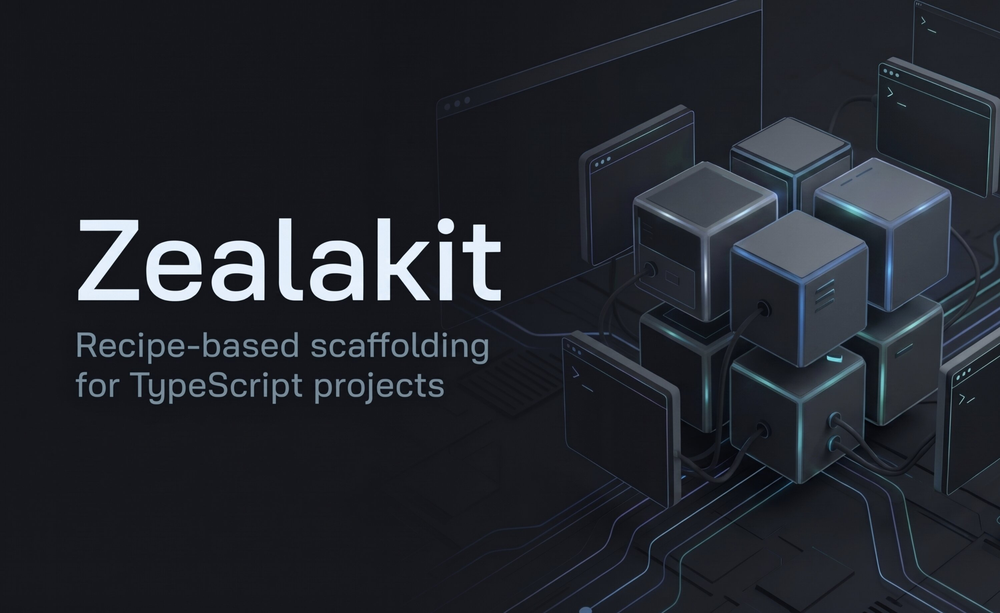

# Zealakit

<p align="center">
  
</p>

**Scaffold dự án TypeScript theo kiểu ghép recipe.**

Chọn template, thêm đúng những recipe cần dùng, nhận project sẵn sàng cài đặt — kèm dependencies, scripts và tài liệu cho AI agent. Không cần cài CLI global.

[English](https://github.com/zealakit/zealakit/blob/main/README.md) · [Tiếng Việt](https://github.com/zealakit/zealakit/blob/main/README_VI.md) · [中文](https://github.com/zealakit/zealakit/blob/main/README_CN.md)

```bash
npx zealakit@latest create
```

---

## Vì sao dùng Zealakit?

Hầu hết starter hoặc quá trống, hoặc nhồi quá nhiều thứ không cần. Zealakit cho phép bạn ghép:

1. **Template** — Vite + React, Vite + Vue, Astro + React (client hoặc hybrid), Next.js, Nuxt, NestJS, Hono, hoặc starter Go API/worker
2. **Recipe** — lớp tùy chọn (Biome, Zustand, shadcn/ui, Drizzle, Storybook, …)

Mỗi recipe mang theo file, package, script và hướng dẫn agent (khi có). Kết quả là một project độc lập bình thường — dùng `npm`, `pnpm`, `yarn` hoặc `bun`.

---

## Yêu cầu

- **Node.js 18+**

---

## Bắt đầu nhanh

```bash
# Tương tác (chọn template thủ công, hoặc Project Discovery)
npx zealakit@latest create

# Gợi ý setup từ yêu cầu của bạn
npx zealakit@latest create --discover

# Tạo từ một template cụ thể
npx zealakit@latest create --template next
```

Sau khi generate:

```bash
cd my-app
npm install
npm run dev
```

### Không tương tác

```bash
npx zealakit@latest create my-app -t next -w biome,shadcn-ui,storybook -y
npx zealakit@latest create api -t nest -w biome,drizzle-orm -y
```

### Xem trước (không ghi file)

```bash
npx zealakit@latest create my-app -t next -w biome,shadcn-ui,storybook --dry-run
```

- Không có `-w` / `-y` → CLI hỏi tương tác.
- `-y` bắt buộc có tên project và bỏ qua bước xác nhận.
- Lệnh gốc `npx zealakit@latest my-app …` vẫn dùng được để tương thích ngược.

---

## Project Discovery

**Project Discovery** hỏi vài câu về những gì bạn đang xây, rồi gợi ý template và chỉ những recipe phù hợp. Bạn xem lại và có thể đổi bất kỳ lựa chọn nào trước khi ghi file.

Dùng Discovery khi chưa chắc starter nào khớp. Prefer `--template` khi đã biết stack.

```bash
npx zealakit@latest create --discover
```

Cách hoạt động:

1. Trả lời câu hỏi ngắn (loại dự án, tùy chọn UI/runtime, extras như database).
2. Xem template **tương thích** xếp hạng kèm giải thích ngắn (starter không khớp bị ẩn).
3. Xem recipe gợi ý — không pre-select thứ không cần thiết.
4. Xác nhận tóm tắt (hoặc quay lại chỉnh câu trả lời / template / recipe).
5. Generate dùng cùng pipeline scaffold như create thủ công.

Bạn luôn giữ quyền kiểm soát: Discovery không cài template/recipe nào bạn chưa chấp nhận ở bước xác nhận.

### Phản hồi Discovery cục bộ

Các phiên Discovery hoàn tất có thể ghi **tóm tắt chỉ trên máy** để bạn nhận ra khoảng trống gợi ý theo thời gian. Không upload; không analytics đám mây.

**Được ghi (chỉ ID và cờ):** trạng thái phiên, ID template/recipe được gợi ý và đã chọn, bạn có đổi gợi ý ban đầu hay không, thành công/thất bại khi generate, và thời lượng (nếu có).

**Không bao giờ ghi:** mã nguồn project, nội dung file, biến môi trường, credential, dữ liệu cá nhân, đường dẫn tuyệt đối, hay câu trả lời thô của questionnaire.

| Lệnh | Mục đích |
| --- | --- |
| `zealakit discovery stats` | Tóm tắt offline (số phiên, template/recipe hay chọn, tín hiệu chẩn đoán) |
| `zealakit discovery feedback status` | Đang bật/tắt và vị trí lưu dữ liệu |
| `zealakit discovery feedback disable` | Ngừng ghi phiên mới (stats cũ vẫn đọc được) |
| `zealakit discovery feedback enable` | Bật lại thu thập |
| `zealakit discovery feedback clear` | Xóa các bản ghi phiên đã giữ |

Lưu trữ: `~/.config/zealakit/discovery-feedback.json` (hoặc `%APPDATA%\zealakit\` trên Windows; ghi đè bằng `ZEALAKIT_CONFIG_DIR`). Giữ tối đa 100 phiên. Có thể tắt qua `ZEALAKIT_DISCOVERY_FEEDBACK=0`. Lỗi ghi feedback không bao giờ chặn generate project.

Tín hiệu từ `discovery stats` chỉ mang tính gợi ý — **không** tự chỉnh trọng số matching.

---

## CLI

```text
npx zealakit@latest create [tên-project] [options]
```

| Option                 | Mô tả                                                                              |
| ---------------------- | ---------------------------------------------------------------------------------- |
| `--discover`           | Project Discovery — gợi ý template/recipe từ yêu cầu của bạn                       |
| `-t, --template <id>`  | Tự chọn template gốc (mặc định: `vite-react`)                                      |
| `-w, --with <recipes>` | Danh sách recipe, cách nhau bởi dấu phẩy (vd. `biome,zustand`)                     |
| `-y, --yes`            | Chế độ không hỏi (bắt buộc có tên project)                                         |
| `--dry-run`            | Xem trước kế hoạch, không ghi file                                                 |
| `-h, --help`           | Xem trợ giúp                                                                       |
| `-V, --version`        | Xem phiên bản                                                                      |

Lệnh khác: `zealakit info`, `zealakit doctor`, `zealakit discovery stats`, `zealakit discovery feedback`.

**Quy tắc**

- `--discover` không kết hợp với `--template`, `-w`, `-y`, hoặc `--dry-run` (Discovery là interactive).
- Tên project theo quy ước npm (chữ thường, không khoảng trắng).
- Thư mục đã có nội dung sẽ hỏi trước khi ghi đè; với `-y` sẽ bị từ chối.
- Recipe sai hoặc xung đột bị từ chối **trước khi** ghi file.
- Generate ghi vào thư mục tạm, validate, rồi mới commit — lỗi giữa chừng không để lại project mới bị dở dang.
- `--dry-run` dùng cùng logic resolve/validate như generate thật (kể cả recipe mặc định và `dependsOn`), in preview, thoát `0` nếu sẵn sàng hoặc `3` nếu bị chặn.
- Mã thoát: `0` thành công hoặc hủy, `2` dùng sai flag, `3` lỗi validate/tương thích, `1` lỗi bất ngờ.

---

## Template

| ID                   | Loại       | Stack                              | Lệnh dev            |
| -------------------- | ---------- | ---------------------------------- | ------------------- |
| `vite-react`         | Client     | Vite + React + TypeScript          | `npm run dev`       |
| `vite-vue`           | Client     | Vite + Vue + TypeScript            | `npm run dev`       |
| `astro-react-client` | Client/SSG | Astro + React islands + TypeScript | `npm run dev`       |
| `astro-react-hybrid` | Hybrid     | Astro + React SSR / Actions / ORM  | `npm run dev`       |
| `next`               | Hybrid     | Next.js App Router + TypeScript    | `npm run dev`       |
| `nuxt`               | Hybrid     | Nuxt + TypeScript                  | `npm run dev`       |
| `nest`               | Server     | NestJS + TypeScript                | `npm run start:dev` |
| `hono`               | Server     | Hono + TypeScript                  | `npm run dev`       |
| `stdlib-api`         | Server     | Go HTTP API (stdlib)               | `make run`          |
| `gin-api`            | Server     | Go HTTP API (Gin)                  | `make run`          |
| `stdlib-worker`      | Infra      | Go background worker (stdlib)      | `make run`          |

Mọi project Node đều có TypeScript, path alias và tài liệu agent (`.agents/`, `AGENTS.md`). Template Go kèm agent docs và Makefile.

---

## Recipe

Mỗi nhóm độc quyền (linter, state, UI kit, HTTP client, ORM, …) chỉ chọn **tối đa một** recipe.

Ngoại lệ:

- **`storybook`** — có thể dùng kèm UI kit
- **`client-shared-pieces`** — tự thêm trên Vite, Astro, Next và Nuxt

| Recipe             | Nhóm           | Template                             | Nội dung                     |
| ------------------ | -------------- | ------------------------------------ | ---------------------------- |
| `biome`            | Linter         | Tất cả                               | Script lint + format         |
| `eslint`           | Linter         | Tất cả                               | ESLint flat config           |
| `zustand`          | State          | Vite React, Astro, Next              | Ví dụ store Zustand          |
| `pinia`            | State          | Vite Vue, Nuxt                       | Ví dụ store Pinia            |
| `nanostores`       | State          | Vite, Astro, Next, Nuxt              | Ví dụ Nanostores             |
| `hookform-zod`     | Forms          | Vite React, Astro, Next              | React Hook Form + Zod        |
| `vee-validate-zod` | Forms          | Vite Vue, Nuxt                       | VeeValidate + Zod            |
| `kyjs`             | HTTP           | Vite, Astro, Next, Nuxt              | Client Ky                    |
| `axios`            | HTTP           | Vite, Astro, Next, Nuxt              | Client Axios                 |
| `antd`             | UI             | Vite React, Astro, Next              | Ant Design                   |
| `mui`              | UI             | Vite React, Astro, Next              | MUI                          |
| `shadcn-ui`        | UI             | Vite React, Astro, Next              | Tailwind + shadcn/ui         |
| `shadcn-vue`       | UI             | Vite Vue, Nuxt                       | Tailwind + shadcn-vue        |
| `nuxt-ui`          | UI             | Vite Vue, Nuxt                       | Tailwind + Nuxt UI           |
| `storybook`        | Docs / testing | Vite, Astro, Next, Nuxt              | Config + script Storybook    |
| `type-orm`         | ORM            | Nest, Hono, Next, Nuxt, Astro hybrid | TypeORM + skill agent        |
| `mikro-orm`        | ORM            | Nest, Hono, Next, Nuxt, Astro hybrid | MikroORM + skill agent       |
| `drizzle-orm`      | ORM            | Nest, Hono, Next, Nuxt, Astro hybrid | Drizzle + script drizzle-kit |
| `prisma`           | ORM            | Nest, Hono, Next, Nuxt, Astro hybrid | Prisma schema + migrate      |

Recipe ORM không gắn cứng driver. Sau khi scaffold, cài driver DB (`pg`, `mysql2`, …) và làm theo skill trong `.agents/skills/<orm>/`.

**Lưu ý hybrid:** ORM trên Next, Nuxt, Astro hybrid, v.v. chỉ phù hợp project **nhỏ** — không mạnh bằng backend framework thuần. Nên dùng backend framework cho API production. CLI cảnh báo ở chế độ tương tác và `--dry-run`.

### Ví dụ

```bash
# SPA: Biome, Zustand, form, Ky
npx zealakit@latest web -t vite-react -w biome,zustand,hookform-zod,kyjs -y

# Vue SPA: Biome, Pinia, VeeValidate, Ky, shadcn-vue
npx zealakit@latest web-vue -t vite-vue -w biome,pinia,vee-validate-zod,kyjs,shadcn-vue -y

# Nuxt: Biome, Pinia, VeeValidate, Ky, Nuxt UI
npx zealakit@latest web-nuxt -t nuxt -w biome,pinia,vee-validate-zod,kyjs,nuxt-ui -y

# Next.js: shadcn/ui + Storybook
npx zealakit@latest next-web -t next -w biome,shadcn-ui,storybook -y

# Astro + React islands: Biome + shadcn/ui
npx zealakit@latest my-astro-app -t astro-react-client -w biome,shadcn-ui -y

# Astro hybrid (SSR + ORM tùy chọn): Biome + Drizzle
npx zealakit@latest my-astro-hybrid -t astro-react-hybrid -w biome,drizzle-orm -y

# Nest API: Drizzle
npx zealakit@latest api-nest -t nest -w biome,drizzle-orm -y

# Hono API: TypeORM
npx zealakit@latest api-hono -t hono -w biome,type-orm -y
```

---

## Sau khi scaffold

```text
my-app/
├─ src/
├─ .agents/          # Skill & rule cho coding agent
├─ AGENTS.md
├─ package.json
└─ …
```

Zealakit chỉ chạy lúc tạo project. App sinh ra không phụ thuộc runtime vào Zealakit và không ép buộc package manager.

Cài và chạy bằng client bạn chọn:

```bash
cd my-app
npm install && npm run dev
# hoặc: pnpm install && pnpm dev
# hoặc: yarn && yarn dev
# hoặc: bun install && bun run dev
```

---

## FAQ

**Zealakit có tự cài dependency không?**  
Không. Tool chỉ ghi file; bạn tự `install` bằng package manager của mình.

**Có chọn hai linter / state / UI kit được không?**  
Không — các nhóm đó độc quyền. Storybook là ngoại lệ.

**Sửa code sau khi generate được không?**  
Được. Coi như một project bình thường.

**Hỗ trợ monorepo chưa?**  
Chưa. Mỗi lần chạy tạo một project độc lập.

---

## Metadata cho tooling

```bash
npx zealakit@latest info --json   # alias: zealakit --info --json
```

In ra stdout đúng một tài liệu JSON (không kèm gì khác): tên/version CLI, template (kèm flow prompt và recipe mặc định), category, recipe (template tương thích, xung đột, package) và các quy tắc tương thích. Key là id cố định; `schemaVersion` chỉ đổi khi có thay đổi phá vỡ tương thích. Không có `--json` thì in bản tóm tắt dễ đọc.

---

## Cấu trúc repository

Repo này là monorepo pnpm. Package npm publish vẫn là **`zealakit`** (root); các workspace package là private và được bundle vào `dist/`.

```text
apps/cli/                   # Entry CLI (prompts, flags, UX, doctor)
packages/core/              # Engine scaffold độc lập ecosystem
packages/ecosystem-node/    # Registry Node + adapter package.json npm
packages/ecosystem-go/      # Phát hiện toolchain Go (tùy chọn)
templates/node/<id>/        # Template gốc Node
templates/go/stdlib-api/    # Template Go HTTP API (stdlib)
templates/go/gin-api/       # Template Go HTTP API (Gin)
templates/go/stdlib-worker/ # Worker nền Go (stdlib)
recipes/node/<id>/          # Recipe Node
recipes/go/                 # Dự trữ (chưa có recipe Go)
```

Kiểm tra môi trường (Go tùy chọn; workflow TypeScript chạy được khi không có Go):

```bash
npx zealakit@latest doctor
npx zealakit@latest doctor --json
```

---

## Giấy phép

[MIT](LICENSE)

Mã nguồn: [github.com/zealakit/zealakit](https://github.com/zealakit/zealakit)
